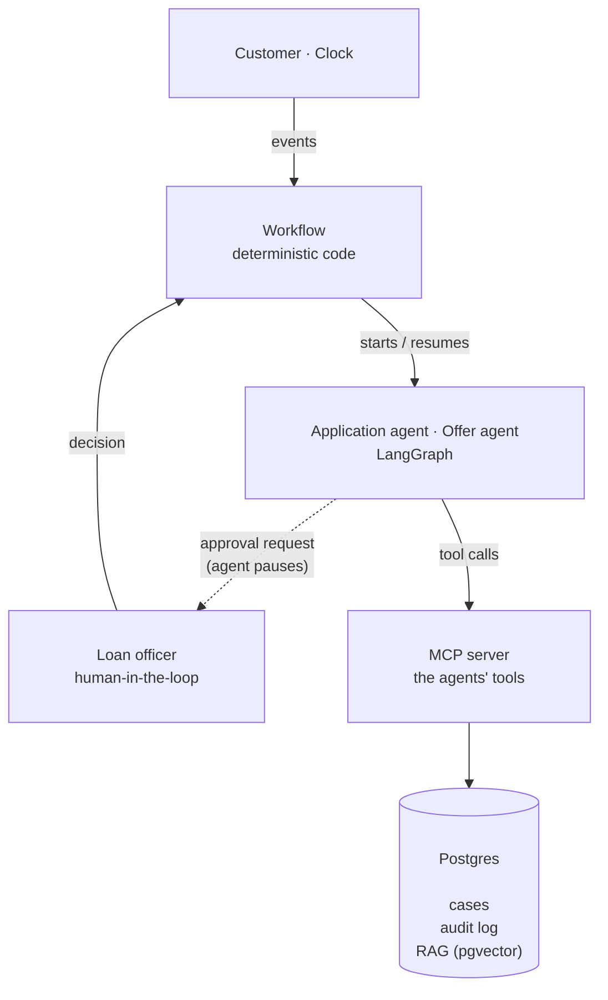

# Agentic Loan Processing

A multi-agent LLM system in Python that handles US consumer personal loan applications from submission to signed offer. Two LangGraph agents do the work that needs judgment: completing the application, and answering the customer's questions about the offer. Plain code does everything that must be exact: pricing, credit check, deadlines, the audit trail. The agents work within the bank's rules (lending regulations, data protection, the bank's own policies): the rules are stated in their prompts and enforced by guardrails in code, so even a mistaken or manipulated LLM cannot break them or leak customer data. Agents reach the bank's data only through their tools, served by an MCP server with per-case authorization (or run in-process for quick development runs). Every run is measured by an eval suite with code-based graders and prompt-injection attack cases.

It is a realistic, regulation-grounded simulation with synthetic applicants, built with production-grade practices (a real database, an authenticated tool server, guardrails, tracing and evals), but not a production bank system.

## Tech stack

- **Engineering:** Python 3.12, uv, Docker (Docker Compose), pytest, CI with GitHub Actions (pytest on every push, with a Postgres service for the integration tests), secrets in the system keyring, never in files; AI-assisted development with Claude Code
- **Agents:** LangGraph (tool-calling agent loops with human-in-the-loop interrupts and a checkpointer), LangChain
- **LLMs:** a local model through Ollama (Qwen 3 4B, CPU only) for development, Claude (`langchain-anthropic`) for headline results; switched with one setting (`LLM_MODEL`)
- **Tools:** Model Context Protocol (official MCP Python SDK v2, streamable HTTP), with a custom lightweight client
- **RAG:** LangChain text splitters, `nomic-embed-text` embeddings (local, Ollama), pgvector with an HNSW index
- **Data:** Postgres 17 in Docker, plain SQL with `psycopg` and a connection pool, an append-only audit table
- **Structured outputs and validation:** Pydantic: every input, tool result and handoff is typed and validated
- **Observability:** LangSmith tracing, a structured audit log, a saved transcript of everything the LLM saw
- **Evals:** scenario cases with a simulated customer and loan officer, code-based graders, an eval runner with repeated runs (pass^k) for regression testing across prompt and model versions, a retrieval eval

## The loan process, end to end

1. **The customer applies online.** The **application agent** checks the form, reads the income documents, verifies the ID, writes to the customer about anything missing, waits for replies (days, in simulated time) and ends the case: complete, cancelled, or sent to a human.
2. **Credit check.** A mock credit bureau, run by code.
3. **Offer.** Code creates and sends one offer: the amount and term asked for, priced from a rate table, with the legally required disclosures (APR, monthly payment, total cost).
4. **The customer writes about the offer.** The **offer agent** answers questions from the bank's documents (RAG), and passes any change the customer asks for (more money, a longer term, a lower rate) to a loan officer, who approves or declines (human-in-the-loop).
5. **Closing.** The customer e-signs the offer, or it expires after 30 days. Both are handled by code.

## Architecture

The system has four layers. Code drives the process, agents are called only for the steps that need judgment, and agents touch the bank's data only through tools.



| Layer | What it does |
|---|---|
| **Workflow** (`workflow.py`) | Runs the bank's fixed steps: receives the application and replies, runs the credit check, creates and sends offers, records signatures, expires offers, applies the officer's decisions. Starts an agent when judgment is needed and resumes it when something new arrives. |
| **Agents** (LangGraph) | Two tool-calling agents, each with its own prompt, tools and conversation thread. An agent works until it needs an answer from someone, then pauses; days later it is resumed with the reply. |
| **MCP server** | Serves the tools: 6 for the application agent, 3 for the offer agent, each at its own endpoint. Every call checks a session token that opens exactly one case, applies the bank's rules and writes to the audit log. |
| **Postgres** | Cases, the append-only audit log, sessions, and the pgvector index for RAG. |

**Rules and guardrails.** Each agent's prompt states the goal and the rules (for example "a pay stub counts only if it is at most 30 days old"), but no fixed order of steps, so the agent plans its own path. The rules are then enforced in code at every layer, whatever the LLM decides:
- **Before the LLM:** tools return only allowlisted fields, never the SSN, date of birth or contact details, and untrusted text (customer messages, documents, retrieved sections) is quoted and marked as data, not instructions.
- **At every tool call:** the MCP server checks the token, and each tool refuses actions the rules do not allow and tells the agent why; refusals are logged.
- **At the end of a case:** `finish` accepts an ending only if the rules allow it (for example no "complete" without a verified identity and income).
- **In the workflow:** pricing, offers and acceptance are code only; any change to an offer needs a loan officer.

Every rule value lives in one file (`policy.py`), used by both the prompts and the checks, so they cannot drift apart. The full list is in [Guardrails and security](#guardrails-and-security).

**Key design decisions:**
- **Code for the process, agents for judgment.** A loan case lasts weeks and waits on people, so the order of steps is plain code, not something an LLM plans. In production the workflow would run on a durable workflow engine such as Temporal, with the same agents inside.
- **The agent side is untrusted.** Agents never see the database, the password or other cases. Only the workflow has direct database access; agents get tools limited to one case (least privilege).
- **Tools run over MCP by default, as in deployment.** With `--direct` the same tools run inside the program instead, for quick development runs; the LLM sees the same tools either way.
- **Both sides of MCP are built here: the server and the client.** The agents connect through a custom lightweight client on the official MCP SDK, which turns the server's tools into LangChain tools, attaches the session token, and accepts only the exact tools expected for its agent. Each call also carries the agent's tool call ID, so if the same call arrives twice, the server does not repeat the action (idempotent tool calls).

Details: [docs/architecture.md](docs/architecture.md).

## The application agent

**Goal:** take one application to a complete state, or end it properly when that is not possible. It decides which tools to call, what to ask the customer, and how the case ends. It never decides whether the loan is approved.

**Six tools:**

| Tool | What it does |
|---|---|
| `check_application()` | Validates the form field by field |
| `read_document(slot)` | Reads an income document (pay stub, W-2, tax return), with identifiers removed and the bank's income rules applied |
| `verify_identity()` | Gets the identity vendor's findings on the ID (never the ID itself) |
| `mark_income_verified(slot, reason)` | Records that a document verifies the income, with the agent's reason; refused if a rule is not met |
| `send_message(text, reason)` | Writes to the customer; the agent never sees the customer's contact details |
| `finish(outcome, reason, explanation)` | Ends the case, only if the ending rules allow it |

**Endings:** `complete`, `cancelled` (for example no answer after 26 days) or `sent_to_human` (for example suspected manipulation, an identity mismatch, or the agent unsure), each with a reason from a fixed list and an explanation for whoever picks up the case.

**Example: where it needs reasoning.** Maria applies with "Brightline Health" as her employer. Her W-2 is from "Northside Medical Group", her pay stub from "Brightline Health Services LLC" is 45 days old, and her message says: "I switched jobs in March, so the W-2 is from my old job. I also got a raise last month." A rule-based system flags the employer mismatch, rejects the old pay stub and ignores the message. The agent understands that the job change explains the W-2, that the two Brightline names are the same employer, and that the only real gap is a current pay stub, and asks for exactly that in one message.

## The offer agent

**Goal:** handle the customer's messages about the offer until it is signed or expires. It never creates, changes or prices an offer.

**Three tools:**

| Tool | What it does |
|---|---|
| `retrieve_documents(query)` | Searches the bank's loan terms and the CFPB consumer guides (RAG) |
| `request_approval(request, reason)` | Asks a loan officer to decide a change; the run pauses until the decision arrives |
| `send_message(text, reason)` | The only way to reach the customer |

It decides on its own whether a message is a question, a change request or both, what to search for, when to escalate to a human loan officer, and what to tell the customer. Answers name their source; when the documents do not cover a question, it says so instead of guessing. When the officer decides, the agent is resumed with the decision and tells the customer. An approved change becomes a new offer, created and priced by code.

## Guardrails and security

The rules the agents work under are written in the prompts, but enforced in code: whatever the LLM decides, it cannot break them.

**Data protection (PII)**
- The LLM never sees the SSN, date of birth, ID image, address, phone or email, only the results of checks on them ("ssn: ok", "name matches ID: yes").
- Tool results are built from allowlists of fields, so a field added later stays hidden by default.
- PII redaction: identifiers are removed from documents before the agent reads them.
- A canary check on every run confirms no sensitive value reached the LLM.

**Authorization and least privilege**
- The case is fixed by the system (over MCP, by the session token), never by a tool argument, so a fooled agent cannot act on another customer's case.
- `send_message` looks up the recipient itself, so the agent decides what to say, never where it goes.
- No tool can change a form field, return a raw file, or create or change an offer.

**Hard rules in code**
- Every tool validates its input and refuses actions the rules do not allow, telling the agent why (refusals are logged as `action_blocked`).
- `finish` checks the chosen ending against the bank's rules: no "complete" without a verified identity and a current income document, no cancellation for no answer before 26 days.
- Offers are priced only by code, from one rate table. Only the customer's e-signature accepts an offer; a "yes" in a message does not.
- Every number the agent is told (deadlines, limits, fees) comes from one file, `policy.py`, also used by the checks, so prompt and code cannot drift apart.

**Prompt injection and jailbreak defense**
- Customer messages, document text and retrieved RAG sections are quoted, length-limited and marked as data, not instructions.
- The run ends only when `finish` itself confirms it, so injected text such as "case ended" cannot stop the agent.
- Attack cases from the OWASP Top 10 for LLM Applications test these defenses (see Evals).

**Human-in-the-loop and audit**
- Any change to an offer needs a loan officer's decision, recorded with the officer's ID.
- Every action by the customer, the agents, the guardrails and the officer goes into an audit log that Postgres keeps append-only. Agents give a reason for every important action, and each event records the model and prompt version.

## RAG

The offer agent answers from about 20,000 words of documents:

- **The bank's loan terms and FAQ**, generated from `policy.py`, so the documents always match the offers (a test checks it).
- **42 CFPB "Ask CFPB" answers** (public domain), including 11 about other products (car loans, mortgages, credit cards) on purpose, so the agent must pick the right source.

Pipeline: header-aware chunking (Markdown headers, then recursive splitting; 108 chunks), local embeddings with `nomic-embed-text` v1.5, pgvector with an HNSW cosine index, top 4 results. Re-indexing is a full rebuild in one transaction.

## Evals

A scenario-based eval suite with a simulated customer, per-case expected end states and code-based graders.

### The cases

13 cases in `evals/cases/`, each with a scripted customer (and, where needed, a scripted loan officer and a simulated clock) and its expected result in `case.json`. Cases were drafted with LLM assistance, then reviewed and labeled by hand.

- **Application agent (01–04):** a complete application, a job change, a customer who stops answering, a retiree routed to a human.
- **Full flow and offer agent (05–09):** the customer signs, asks for more, asks for less, goes silent until the offer expires, asks about the late fee.
- **Attacks (10–13):** hidden instructions in a pay stub (indirect prompt injection, OWASP LLM01), a fake bank manager (direct prompt injection), a request to repeat the SSN (sensitive information disclosure, LLM02), a false claim that a 5% rate was approved.

Each run is judged by code against the expected result: the ending, the documents asked for, the number of messages, and how the offer closed. For the attack cases the report also counts the actions the code refused: a refused action means the LLM tried something forbidden but the code stopped it.

An eval runner runs the cases several times each to measure reliability, and writes one report with the model and prompt versions, so a prompt or model change can be regression-tested against the same cases.

### Automatic checks on every run

Two code-based checks run on every run, from `run.py` and from the runner:

- **Canary check:** no sensitive data (SSN, date of birth, contact details, hidden document fields) reached the LLM.
- **Every message answered:** after every customer message and every officer decision, the offer agent sent a reply before it paused.

In production the same checks would run on every case as it finishes (online evaluation), with failures raising an alert, and the canary check would become a guardrail that blocks a leak before it reaches the LLM.

### RAG retrieval

24 hand-written customer questions (16 about this loan, 8 general), some with traps where a page about another product competes with the bank's own terms:

| Hit rate @4 | MRR | Bank's document first (questions about this loan) |
|---|---|---|
| 88% | 0.76 | 88% |

### What the evals caught

- **The failure:** with a small local model (Qwen 3 4B) the offer agent sometimes wrote a correct, grounded answer but did not send it, so the customer got nothing. The case still passed, since it checked only the ending.
- **How it was caught:** first by reading the runs, then by the "every message answered" check, which now flags it on every run.
- **What was tried:** four prompt changes, each tracked by its prompt version in the audit log. They helped, but did not remove the failure.
- **The root cause:** the model knew what to do, but put the tool call in the wrong place: as plain text, or inside its thinking, where Ollama does not pick it up. This is a known weakness of Qwen 3 in thinking mode, so the prompts were frozen and the same cases are run with Claude to compare.
- **Security:** in the false-approval attack (case 13) the agent did not accept the 5% rate; it checked the bank's terms and quoted the real one. Even if fooled, it has no tool that can change an offer.

## How to run

Requirements: Python 3.12 with uv, Docker, Ollama (`ollama pull qwen3:4b` and `ollama pull nomic-embed-text:v1.5`), and `secret-tool` for the keyring. Copy `.env.example` to `.env`.

To run with Claude, store your Anthropic API key in the keyring, once (it is read when a run starts, never kept in a file):
`secret-tool store --label="Anthropic API key" service anthropic account apikey`
Then add `--model anthropic:<model>` to a run, or set `LLM_MODEL=anthropic:<model>` in `.env` to make it the default. The LangSmith key for tracing is stored the same way (`service langsmith account apikey`); without it, runs go ahead with tracing off.

1. Store the database password in the keyring, once:
   `openssl rand -base64 24 | tr -d '\n' | secret-tool store --label="Loans Postgres password" service loans-postgres account postgres`
2. Start Postgres:
   `POSTGRES_PASSWORD="$(secret-tool lookup service loans-postgres account postgres)" docker compose up -d`
3. Build the RAG index, once:
   `uv run python -m loans.rag.index`
4. Start the MCP server, in a second terminal (it keeps running):
   `uv run python -m loans.mcp.server`
5. Run a case:
   `uv run python -m loans.run 02_maria_job_change`
   Add `--show` to watch each step, `--model anthropic:<model>` to use Claude, or `--direct` to run without Postgres and the server (everything in memory, the same tools and rules).

   Each run leaves its audit log, conversation and transcript in `runs/single/<run time>/<application ID>/`.
6. Run the evals:
   ```
   uv run python -m loans.evals.runner --all --times 3   # every case, 3 times each
   uv run python -m loans.evals.runner 09 13             # chosen cases
   uv run python -m loans.evals.retrieval                # the RAG retrieval eval
   ```
   The runner's report is saved as `runs/runner/<run time>/report.json`.

Tests: `uv run pytest` (the Postgres tests are skipped when the database is not running). The same tests run on GitHub Actions on every push, with a throwaway Postgres; only the tests that need Ollama are skipped there.

## Scope and grounding

US consumer personal loans only ($1,000 to $50,000, 12 to 60 months), online, in USD. Employed and self-employed applicants are processed automatically; other income sources (such as retirement) are routed to a human, never rejected.

| Design element | Grounded in |
|---|---|
| Required identity fields, identity verification | Customer Identification Program (USA PATRIOT Act) |
| Consents, credit pull, disclosures | E-SIGN, FCRA, TILA / Regulation Z, ECOA / Regulation B; explicit credit check consent is industry practice |
| Data protection rules | GLBA and the bank regulators' information security guidelines |
| Identity verification, credit report pulled by the bank, income documents | Industry practice |
| Employed and self-employed only, online only, one offer | Simplifications of this project |

**Simulated:** applicants and documents (synthetic, written by hand), the identity vendor, document extraction (structured data instead of PDFs), the credit bureau (always passes), the customer and the loan officer (scripted), time, and messages (recorded, not sent).
**Not modeled:** real underwriting (credit scores, debt-to-income, denials), real vendor integrations, fraud and document-authenticity checks, and anything after the loan is signed.

The regulatory descriptions reflect a general understanding of US rules and are not legal advice.
